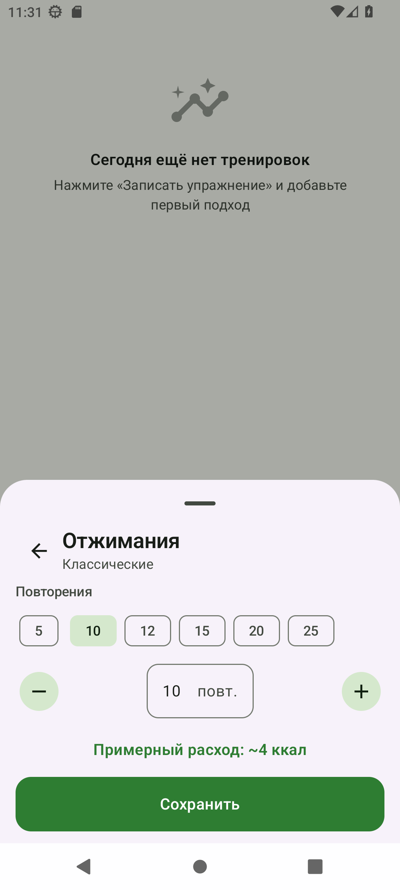

# Фитнес-трекер 🏋️

Современное, минималистичное и быстрое Android-приложение для учёта тренировок.
**Полностью офлайн** — без регистрации, аккаунтов и бэкенда. Все данные хранятся только на устройстве.

<p>
  
  &nbsp;
  
  &nbsp;
  
  &nbsp;
  
</p>

## Возможности

- ⚡ **Запись подхода за 3 секунды**: открыл → выбрал упражнение → сохранил
- 📚 **26 предустановленных упражнений** с разделением по хватам: свой вес, турник, гантели, пресс, кардио
- ➕ **Свои упражнения** — создайте упражнение, если нужного нет в справочнике
- 🔥 **Автоматический подсчёт калорий**:
  - кардио — MET линейно интерполируется по скорости (4 км/ч ≈ 3.0, 8 км/ч ≈ 8.3, 10 км/ч ≈ 9.8, 12 км/ч ≈ 11.5);
  - силовые — энергоёмкость 1 повторения с поправкой на вес тела и вес гантелей;
  - статика (планка) — MET 3.8 от длительности.
- 📊 **Экран «Сегодня»**: сожжено ккал, всего повторений, время кардио; лента подходов; удаление свайпом с отменой
- 🗓 **История**: лента дат с точками-индикаторами, сводка дня и раскрывающийся детальный лог
- ⚖️ **Профиль**: вес тела (влияет на расчёт), тема (системная/светлая/тёмная), экспорт JSON/CSV, очистка данных
- 🌓 Материальный дизайн 3, светлая и тёмная темы, аккуратная типографика

## Технологии

| | |
|---|---|
| Язык | Kotlin 2.0 |
| UI | Jetpack Compose + Material Design 3 |
| Архитектура | MVVM + Clean Architecture (UI → ViewModel → Repository → Room DAO) |
| Реактивность | StateFlow + Kotlin Coroutines |
| Хранение | Room Database (SQLite) + Jetpack DataStore |
| Навигация | Jetpack Navigation Compose (3 вкладки) |
| DI | Ручной контейнер (без внешних библиотек) |

## Сборка

Требуется Android Studio (или JDK 17 + Android SDK 35).

```bash
git clone https://github.com/Kakuzaaa/fit_track.git
cd fit_track
./gradlew :app:assembleDebug
```

Готовый APK доступен в разделе [Releases](https://github.com/Kakuzaaa/fit_track/releases).

## Структура проекта

```
app/src/main/java/com/example/fitnesstracker/
├── FitTrackerApp.kt          # Application + DI-контейнер
├── MainActivity.kt
├── domain/                   # Модели, enum-ы, интерфейсы репозиториев
├── data/
│   ├── local/                # Room: Entity, DAO, Database + предзаполнение
│   ├── preferences/          # DataStore (вес, тема)
│   ├── mapper/               # entity ↔ domain
│   └── repository/           # Реализации репозиториев
├── util/                     # CalorieCalculator, Formatters
└── ui/                       # theme, navigation, today, quicklog, history, profile
```

## Расчёт калорий

`CalorieCalculator` берёт вес тела из настроек (по умолчанию 75 кг):

- **Кардио**: `Ккал = MET(скорость) × вес × время`, MET — линейная интерполяция по опорной таблице;
- **Силовые**: `(база × вес/75 + 0.005 × вес гантели) × повторения`;
- **Статика**: `MET 3.8 × вес × время`.

---

Лицензия: MIT
