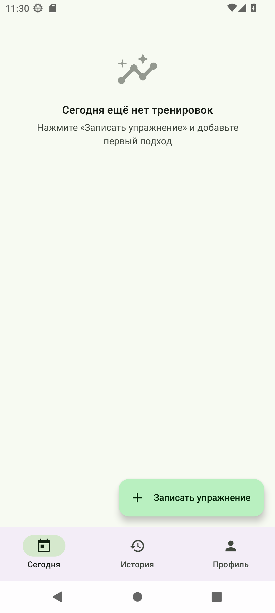
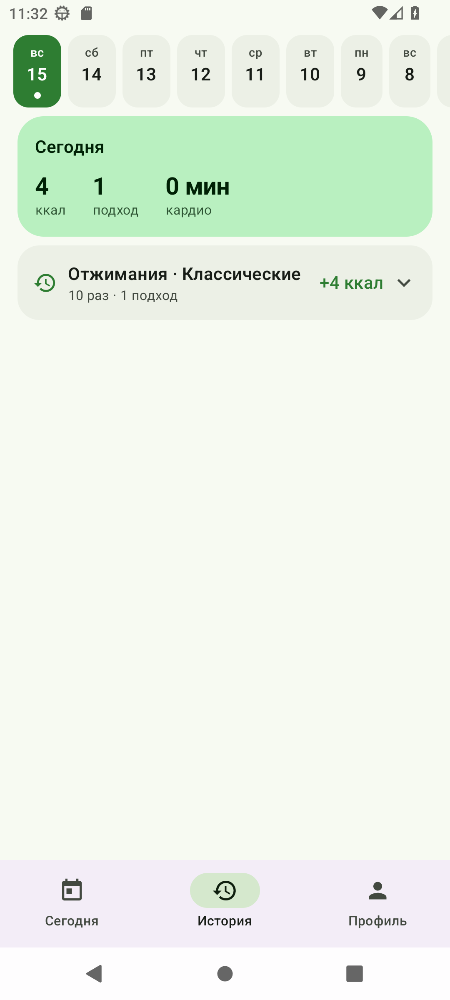
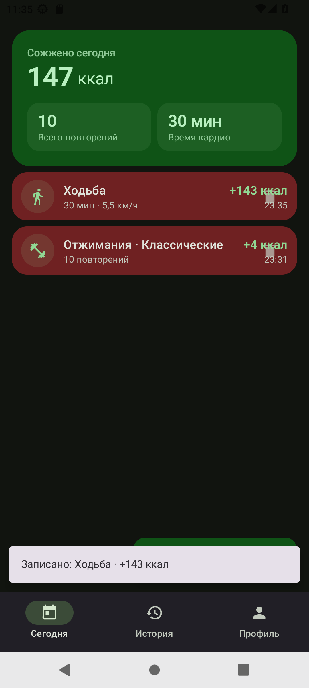

# Фитнес-трекер 🏋️

Современное, минималистичное и быстрое Android-приложение для учёта тренировок.
**Полностью офлайн** — без регистрации, аккаунтов и бэкенда. Все данные хранятся только на устройстве.

<p>
  
  &nbsp;
  
  &nbsp;
  
  &nbsp;
  
</p>

## Возможности

- ⚡ **Запись подхода за 3 секунды**: открыл → выбрал упражнение → сохранил
- 🎥 **100% точные анимации техники**: отдельные анатомические Lottie, GIF и WebP-анимации для каждого упражнения
- 🗺️ **Интерактивная анатомическая карта мышц (Muscle Map)**: визуализация передней и задней проекции тела с цветовой подсветкой целевых мышц и синергистов
- 🏆 **Личные рекорды (PR) и калькулятор 1RM**: расчёт одноповторного максимума (формулы Эпли и Бржицки), таблица процентов рабочего веса (70%–100%) и праздничные бейджи рекордов
- 📋 **Программы и шаблоны тренировок (Routines)**: готовые комплексы («Базовый воркаут», «Верх тела & Гантели», «Пресс & Кор») и конструктор собственных программ с быстрым стартом
- ⏱️ **Интерактивный таймер отдыха**: плавающая капсула с кнопками `+30 с`, `-15 с`, `Пропустить` и виброоткликом
- 📈 **Аналитика прогресса по упражнениям**: графики динамики за 7 дней, тоннаж, история подходов
- 📚 **63 упражнения в справочнике** с разделением по хватам: свой вес, турник, гантели, пресс, кардио, пауэрлифтинг
- ➕ **Свои упражнения** — создайте любое упражнение, если нужного нет в справочнике
- 🔥 **Автоматический подсчёт калорий**:
  - кардио — MET линейно интерполируется по скорости (4 км/ч ≈ 3.0, 8 км/ч ≈ 8.3, 10 км/ч ≈ 9.8, 12 км/ч ≈ 11.5);
  - силовые — энергоёмкость 1 повторения с поправкой на вес тела и вес отягощения;
  - статика (планка) — MET 3.8 от длительности.
- 🏃 **Кардио по расстоянию**: укажите дистанцию и скорость — длительность рассчитается сама (или задайте её вручную)
- 🔁 **«+1 такой же подход»** в один тап рядом с каждой записью и ✏️ **редактирование** записей (включая прошлые дни)
- 🎯 **Дневная цель по ккал** с прогресс-баром и **стрик** тренировочных дней
- 📊 **График за 7 дней** в истории (ккал / повторения, среднее за день)
- 🗓 **История**: календарная лента дат, сводка дня и раскрывающийся детальный лог
- 🔄 **Встроенное автообновление**: проверка новых релизов с GitHub, надёжное скачивание APK с докачкой (HTTP Range), автоповторами при разрывах (`Connection reset`), и кнопкой скачивания через браузер
- ⚖️ **Профиль**: вес тела, темы (светлая/тёмная/системная), экспорт JSON/CSV, импорт данных
- 🌓 Материальный дизайн 3, светлая и тёмная темы, аккуратная типографика

## Технологии

| | |
|---|---|
| Язык | Kotlin 2.0 |
| UI | Jetpack Compose + Material Design 3 |
| Архитектура | MVVM + Clean Architecture (UI → ViewModel → Repository → Room DAO) |
| Реактивность | StateFlow + Kotlin Coroutines |
| Хранение | Room Database (SQLite) + Jetpack DataStore |
| Навигация | Jetpack Navigation Compose (3 вкладки) |
| DI | Ручной контейнер (без внешних библиотек) |

## Сборка

Требуется Android Studio (или JDK 17 + Android SDK 35).

```bash
git clone https://github.com/Kakuzaaa/fit_track.git
cd fit_track
./gradlew :app:assembleDebug
```

Готовый APK доступен в разделе [Releases](https://github.com/Kakuzaaa/fit_track/releases) — актуальная версия **v1.5.0**.

## Структура проекта

```
app/src/main/java/com/example/fitnesstracker/
├── FitTrackerApp.kt          # Application + DI-контейнер
├── MainActivity.kt
├── domain/                   # Модели, enum-ы, интерфейсы репозиториев
├── data/
│   ├── local/                # Room: Entity, DAO, Database + предзаполнение
│   ├── preferences/          # DataStore (вес, тема)
│   ├── mapper/               # entity ↔ domain
│   └── repository/           # Реализации репозиториев
├── util/                     # CalorieCalculator, Formatters
└── ui/                       # theme, navigation, today, quicklog, history, profile
```

## Расчёт калорий

`CalorieCalculator` берёт вес тела из настроек (по умолчанию 75 кг):

- **Кардио**: `Ккал = MET(скорость) × вес × время`, MET — линейная интерполяция по опорной таблице;
- **Силовые**: `(база × вес/75 + 0.005 × вес гантели) × повторения`;
- **Статика**: `MET 3.8 × вес × время`.

---

Лицензия: MIT
